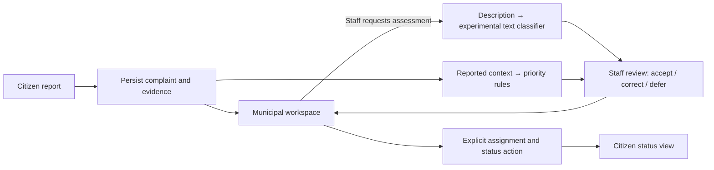
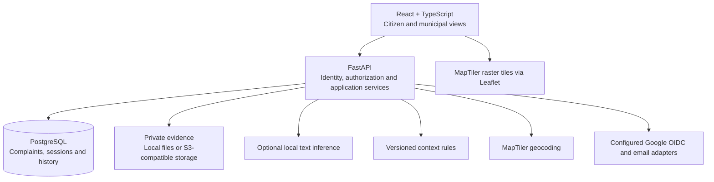

# CivicAI
### AI-Based Urban Civic Complaint Classification and Prioritization System

[](https://github.com/Soumodeep-Das/civic-ai/actions/workflows/quality.yml)

**An MCA project for reporting Indian civic issues and supporting accountable municipal review.**

Citizens submit a description, photo, issue location and reported impact. Municipal staff review protected evidence, manage responsibility and status, and inspect experimental classification and priority suggestions with recorded explanations.

[Project guide](docs/README.md) · [System design](docs/ARCHITECTURE.md) · [Research results](research/EXPLORATORY_BASELINE_RESULTS.md) · [Limitations & major scope](docs/ROADMAP.md) · [Demo guide](docs/MINOR_DEMO_RUNBOOK.md)

> **Current scope — November 22, 2026:** the local demonstration integrates a small text classifier and a transparent context-based priority policy. Photos remain evidence for human inspection. Image classification, validated severity and the planned multimodal comparison are unfinished research objectives. The November 27 presentation build is feature-frozen.

## What the product does

| Citizen experience | Municipal experience |
|---|---|
| Report anonymously or through an optional account | Sign in with explicit staff roles and department permissions |
| Attach a JPEG/PNG and confirm a searched, device or map location | Inspect protected photos, location and original description |
| Report danger, access blockage and service disruption, including “Not sure” | Review separate category and priority suggestions |
| Save a private tracking link or use My Complaints | Accept, correct or defer suggestions with explanations |
| Verify email, reset a password or use configured Google sign-in | Assign work and update status with recorded history |

The citizen form requires photo and location; the API preserves legacy submissions that omit them. Google sign-in grants citizen access only. Staff access is provisioned by administrators.

## One report, three separate decisions



**Category** identifies the type of issue. **Severity** would describe its evidenced condition and is not predicted here. **Priority** suggests attention based on reported context. Suggestions do not automatically change complaint status, assignment or routing.

## What the ML currently demonstrates

| Item | Actual scope |
|---|---|
| Source | OpenCity/Janaagraha IChangeMyCity, Bengaluru; 16,071 acquired text records |
| Exploratory fit | 97 screened descriptions with **AI-proposed labels** |
| Supported families | Roads/pedestrian access, solid waste, drainage/sewerage, public lighting |
| Method | TF-IDF + logistic regression; three grouped development folds |
| Selected mean macro-F1 | **0.8644**, versus **0.1434** for the majority-class comparator |
| Meaning of the result | Agreement with AI labels on folds also used for model selection |
| Review behavior | Heuristic guards defer some unsupported, conflicting or insufficient inputs; staff review is mandatory |

These scores are **not independent test accuracy**. There is no demonstrated West Bengal, all-India, Bengali/Hindi, image or severity performance. The application accepts broader civic complaints than this four-family model supports.

The original eight-category taxonomy remains a proposal. The exploratory four-family experiment is separately documented and does not approve the original human-reviewed release. See the [experiment report](research/EXPLORATORY_BASELINE_RESULTS.md), [protocol](research/protocols/exploratory_ai_labels_v1.json) and [research workspace](research/README.md).

**A fresh clone does not include the private dataset or trained model.** Core complaint features work without the model. Experimental generation returns a clear unavailable response until a trusted local artifact and its SHA-256 are configured. Follow [ML demo setup](docs/ML_DEMO.md); never load an arbitrary uploaded joblib file.

## System at a glance



| Layer | Stack |
|---|---|
| Browser | React, TypeScript, Vite, Leaflet |
| API and persistence | Python 3.12, FastAPI, Pydantic v2, SQLAlchemy 2.x, Alembic, PostgreSQL |
| Experimental ML | scikit-learn, TF-IDF, logistic regression, joblib |
| Verification | pytest, isolated PostgreSQL schemas, Vitest/Testing Library, GitHub Actions |
| Deployment | Docker Compose + Caddy; alternative Render/Supabase/Brevo beta path |

See [architecture](docs/ARCHITECTURE.md) for request sequences, data relationships and trust boundaries.

## Run locally on Windows

Prerequisites: **Python 3.12**, **Node.js 22.12+**, and a running PostgreSQL instance (CI uses 18.1). Commands below run from a new checkout in PowerShell.

```powershell
git clone https://github.com/Soumodeep-Das/civic-ai.git
Set-Location civic-ai
py -3.12 -m venv .venv
.\.venv\Scripts\python.exe -m pip install -e ".[test,research]"
Copy-Item .env.example .env
Set-Location frontend
npm ci
Set-Location ..
```

Copy the environment example only for initial setup; preserve any populated environment file. Using PostgreSQL administration tools, create separate `civicai` and `civicai_test` databases. The test role needs permission to create schemas. Populate the ignored `.env`:

| Configuration | Purpose |
|---|---|
| `DATABASE_URL` | Development database, using `postgresql+psycopg://` |
| `TEST_DATABASE_URL` | Different disposable database with a name ending in `_test` |
| `GEOCODING_PROVIDER=maptiler`, `MAPTILER_API_KEY` | Autocomplete/reverse geocoding |
| `VITE_MAPTILER_API_KEY` | Browser-visible map tile key; restrict allowed origins and usage |
| `MAPTILER_REQUEST_ORIGIN` | Actual CivicAI origin when the shared key is origin-restricted |
| Google OAuth settings | Optional; needed only for Google sign-in |

A one-key MapTiler plan can reuse the same key for backend and frontend. That value becomes publicly observable. Separate keys remain supported. Without a tile key the UI shows a configuration message; it does not use an anonymous tile fallback.

```powershell
.\.venv\Scripts\python.exe -m alembic upgrade head
.\.venv\Scripts\python.exe -m civicai.bootstrap_admin
powershell -NoProfile -ExecutionPolicy Bypass -File .\scripts\start-dev.ps1
```

Bootstrap prompts privately and refuses when an active administrator already exists. Run it only for initial provisioning. Open [citizen portal](http://127.0.0.1:5173/), [staff sign-in](http://127.0.0.1:5173/staff/sign-in) or [API docs](http://127.0.0.1:8000/docs). Backend port defaults to 8000; `BACKEND_PORT` changes both the launcher and Vite proxy after restart.

Development email capture writes private verification/reset/invitation JSON messages to ignored `tmp/dev-mail`. Production/beta reject capture and disabled email modes; configure SMTP or Brevo as appropriate. The local Docker demo uses a loopback-only Mailpit inbox. Details: [deployment](docs/DEPLOYMENT.md).

## Test and build

```powershell
.\.venv\Scripts\python.exe -m pip check
.\.venv\Scripts\python.exe -m pytest backend/tests research/tests -q -p no:cacheprovider --basetemp tmp/pytest-local
Set-Location frontend
npm test
npm run build
Set-Location ..
```

Tests require the dedicated test database and apply real migrations in isolated schemas. Never point them at the normal application database. The private-model integration test skips when its artifact is absent, including a normal CI checkout; a green CI build does not prove that artifact ran. Research tests use fixtures and do not retrain the private model.

[Verification history](docs/CURRENT_STATE.md) distinguishes local tests, CI, owner reports and browser checks. Test counts are dated evidence, not a permanent coverage or security guarantee.

## Choose the right deployment

| Environment | Purpose and boundary |
|---|---|
| Local Vite + FastAPI | Development; `.env`; frontend 5173 |
| Local Docker demonstration | HTTPS at localhost; `start-ml-demo.ps1` adds the private model and local Mailpit; needs existing private artifacts |
| Base production Compose | Caddy, private backend/PostgreSQL and evidence volume; default build has no experimental model |
| Closed beta | Render serves UI/API; Supabase supplies database/private storage; Brevo supplies email |

The [closed-beta URL](https://civicai-beta.onrender.com/) has previously reported citizen-flow verification. Current local ML verification does not establish what is deployed there or guarantee availability. Follow [beta notes](docs/ISSUE_014_CLOSED_BETA.md) before using it.

For deployment and recovery, read [deployment](docs/DEPLOYMENT.md), [backup/restore](docs/BACKUP_RESTORE.md) and [operations](docs/OPERATIONS_RUNBOOK.md). A created backup is not a proven restore. Keep all populated environment files, evidence, backups and model artifacts outside Git.

## Repository map

```text
backend/          API, application services, database models, migrations, tests
frontend/         Citizen and municipal React views, map, API clients, tests
research/         Protocols, acquisition/curation tools, experiments, result notes
docs/             Architecture, API contract, setup/operations and academic scope
docs/reference/   Approved synopsis and original template
deploy/           Caddy and container deployment support
scripts/          Development, deployment, backup and verification helpers
data/             Ignored local datasets and evidence; placeholders only in Git
ml/               Reserved directory; active experiment code lives in research/
.github/          CI test, audit and build workflow
```

## Limitations and major-project direction

The minor deliverable is an integrated experimental system. Independent labels and evaluation, image/multimodal classification, category-specific severity, broader Indian coverage and contextual ranking remain substantial research work. Product gaps include status notifications, richer communication and broader accessibility/device validation. Operational gaps include a Python lockfile, shared abuse controls, monitoring and formal recovery/scale validation.

The [major-project roadmap](docs/ROADMAP.md) connects each gap to an acceptance criterion. It makes no promise of image-severity accuracy, emergency response, municipal adoption or novel algorithms.

## Academic provenance and reuse

The [approved synopsis](docs/reference/project-synopsis.docx) records the original intent; [project context](docs/PROJECT_CONTEXT.md) explains the delivered minor scope and unfinished comparison. Dataset attribution and use boundaries are recorded in the [experiment report](research/EXPLORATORY_BASELINE_RESULTS.md) and [source register](research/SOURCE_REGISTER.md). Runtime citizen submissions are excluded from research by default.

This repository currently has **no software license file**. Public visibility does not establish an open-source reuse license. Dataset and third-party dependency licenses are separate; no license is invented by this documentation review.
