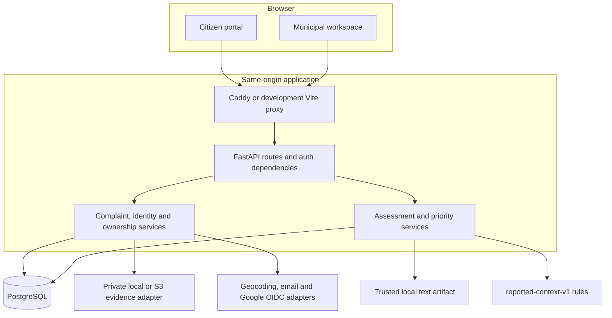
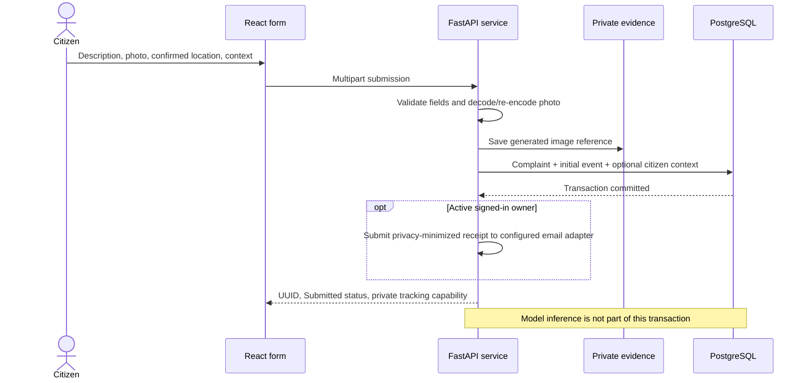
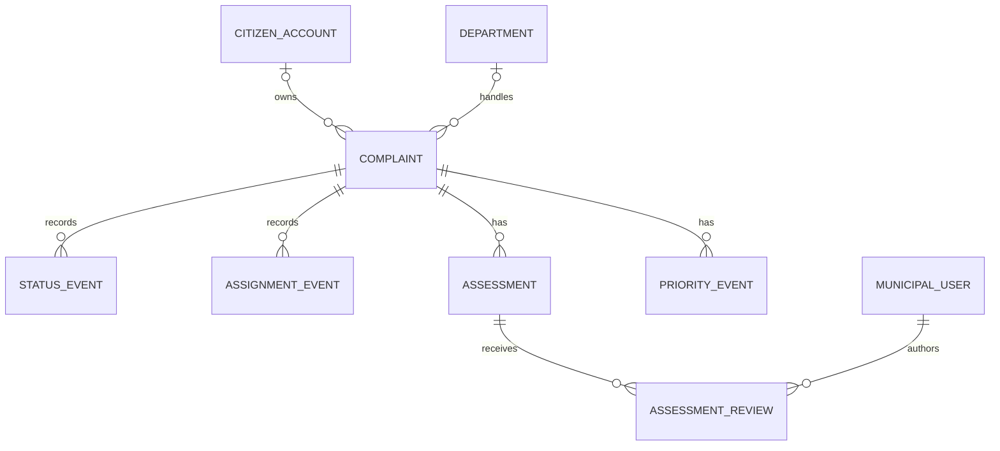

# System architecture
Updated November 22, 2026. This page describes implemented components; the [roadmap](ROADMAP.md) describes future work.

## Runtime boundaries

CivicAI is a React client and one FastAPI application backed by PostgreSQL. Request schemas, application services and persistence are separate modules. Research acquisition/training stays offline; the optional inference service loads a trusted local model artifact.

For the beta topology, FastAPI serves the built SPA directly; Caddy/Vite are not part of that runtime. Map tiles are requested directly by Leaflet using a browser-public MapTiler key. Geocoding stays behind the API.

## Module map

| Responsibility | Implementation |
|---|---|
| Startup, errors, health and headers | `backend/src/civicai/main.py` |
| HTTP contracts and routes | `schemas.py`, `routes.py`, `identity_routes.py` |
| Complaint lifecycle and ownership | `service.py`, `domain.py`, `ownership.py` |
| Sessions, citizen identity, federation | `auth.py`, `citizen_auth.py`, `oidc.py` |
| SQLAlchemy persistence | `models.py`, `database.py`; Alembic in `backend/migrations/` |
| Image validation and private storage | `uploads.py`, `evidence.py` |
| Transactional complaint notifications | `notifications.py`, using `emailing.py` adapters |
| Experimental assessment | `assessments.py`, `assessment_contract.py`, `assessment_policy.py` |
| Contextual priority | `priorities.py`, `priority_policy.py` |
| Citizen and municipal UI | `frontend/src/App.tsx`, `frontend/src/admin/` |
| Offline study | `research/civicai_research/` and versioned protocols |

## Submission and persistence

Database records commit atomically. File storage is a separate resource: ordinary database failures clean up newly stored evidence, but a process crash can leave an orphan. The media audit reports inconsistency without deleting files.

## Logical data relationships

This is a logical overview, not a full physical schema. Original evidence, model suggestions and staff reviews remain distinct. Status/assignment histories have database immutability protection; do not infer the same trigger guarantees for assessment/priority events. See [data specification](DATA_SPECIFICATION.md) and migrations through `0011`.

## Experimental decision support

The text service checks complaint access, verifies the operator-configured artifact SHA-256, loads its pipeline and applies versioned heuristics. It records description fingerprint, model identity, state, reasons and mandatory review. Missing/invalid configuration returns 503. Reviews preserve the original output; description-stale reviews fail. Inference is synchronous, with no job queue or background worker. Repeated successful generation/review requests can create additional history; global retry idempotency is not implemented.

The priority service uses three explicit facts: immediate danger, blocked access and service interruption. Citizen values are yes/no/unknown; staff may also record conflict. It keeps provenance and unknowns, serializes writes with a complaint-row lock and rejects reviews of superseded/description-stale context. The policy emits Medium, High or needs-review. Staff corrections may use Low/Medium/High/Critical. No suggestion automatically mutates operational workflow. See [priority specification](CONTEXTUAL_PRIORITY.md).

## Identity and privacy

- Citizen and municipal identities are distinct. Google/email matching never grants staff authority.
- Opaque session cookies map to hashed PostgreSQL session records. Protected writes enforce CSRF/origin checks.
- Staff evidence access is complaint-scoped; the owning signed-in citizen can also retrieve their evidence. Anonymous tracking exposes a restricted status view.
- Evidence remains private in filesystem/S3 storage and is served through authorized API routes.
- Photos are validated JPEG/PNG, at most 5 MiB and 20 million pixels, re-encoded without source metadata.
- Precise coordinates, photos, tokens and internal notes must not be copied into public documentation.
- The browser MapTiler key is publicly observable; if shared with geocoding, that shared value is also public.
- Account-owned complaint emails contain only citizen-safe status, reference and a same-origin account link. They exclude internal notes, complaint text, evidence and location. Anonymous complaints have no email notification path.

## Deployment designs

| Design | Public entry | Storage and optional services |
|---|---|---|
| Development | Vite 5173 → FastAPI 8000 by default | Local PostgreSQL/files; ignored JSON email capture |
| Production Compose | Caddy HTTPS → private Uvicorn | Private PostgreSQL and evidence volumes; configured email |
| Local ML demo overlay | Same Compose entry | Read-only single-model mount; research dependency extra; loopback Mailpit |
| Closed beta | Render FastAPI serves SPA + API | Supabase PostgreSQL/private S3-compatible storage; Brevo HTTPS email |

Caddy routes API paths before SPA fallback, enforces a 6 MiB outer body limit and serves fingerprinted assets with immutable caching. Compose publishes neither backend nor database ports. Vite never runs in production.

`/health` indicates process liveness. `/ready` checks database connectivity, exact migration head and evidence-storage readiness; it does not certify model, map, email or Google availability. S3 readiness checks bucket access, whereas local evidence checks filesystem access.

## Operational limits

The system has no automatic failover, distributed rate limiting, inference job queue, learned routing or validated capacity/SLA claim. Complaint notification submission is synchronous and best-effort after the database commit; there is no durable outbox, retry worker, bounce tracking, SMS or per-account preference yet. Backups coordinate PostgreSQL and evidence, with disposable restore verification documented separately. The local artifact's hash establishes integrity, not trust in pickle/joblib deserialization. Public clones and base deployment images do not contain the private model.

[API contract](API_CONTRACT.md) · [Deployment](DEPLOYMENT.md) · [Recovery](BACKUP_RESTORE.md) · [Research boundary](RESEARCH_PLAN.md)
